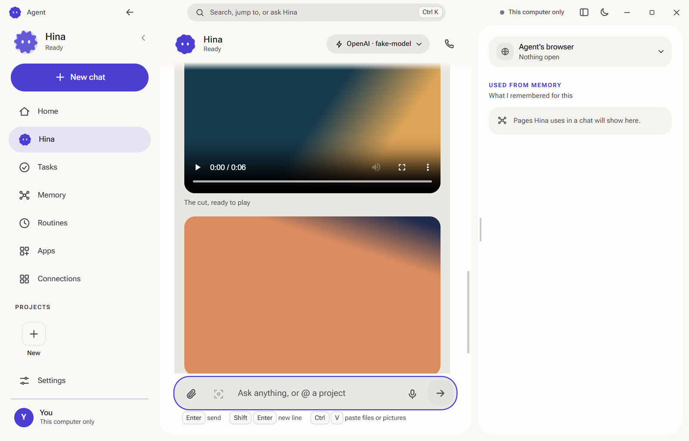
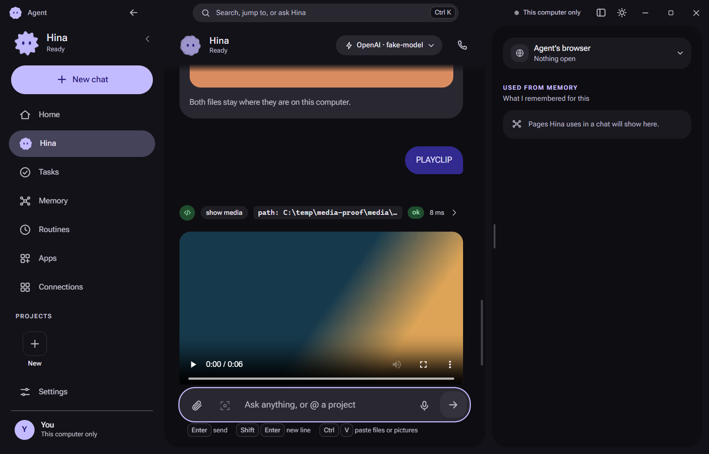

# Agent for Windows

The agent itself, on your own computer. It thinks, browses with its own browser, keeps a wiki memory of what it learns
about you, runs jobs on a clock, and does the work with the files and the accounts that are already on this machine.

Your phone can pair with it, and then the phone is the window and this computer does the work. Or you use it here on its
own. You bring the model: an API key, or the ChatGPT or Claude plan you already pay for.

**Download:** [the latest release](https://github.com/Past-da-king/agent-desktop-app/releases/latest) · Windows 10 and 11, 64-bit
**Phone half:** [Past-da-king/agent](https://github.com/Past-da-king/agent)

Free, open source, MIT. No account, no subscription, no server of ours: the model is the only thing that leaves this machine.

## What it looks like



The agent does not answer with a path. A video, a picture or a sound it has on this computer lands in the chat and plays
there, with a real player and a click to enlarge. The file stays where it is and is never copied anywhere.



## What it can actually do

**It reads your machine.** Your folders, your documents, your shell, your installed tools. It asks before it changes
anything: the card shows the exact command or the exact file it is about to touch.

**It answers in cards, not walls of text.** A table, a chart, a set of steps, a row of buttons, one card per option: an
answer you can read at a glance and act on. Long work goes in a report beside the chat.

**It shows you your own files.** Videos, pictures and sounds play in the chat instead of making you open another program.

**It remembers you.** Every person, place, company and project gets a page in a wiki, linked to the pages around it. You
can read it, change it, or pin it, and it is the agent's own memory rather than a black box.

**It runs on a clock.** A routine can fire at a set time, when a mail arrives, or the moment a file changes. Routines
work with the same tools the agent has, including your task list.

**It learns the web apps you use.** Show it a site once and it can write its own tools for that site, so the next time it
is one call instead of a hundred clicks. You decide whether those tools may act without asking.

**It builds little apps for you.** A mini-app is a dashboard or a tracker it makes and then keeps up to date, in light and
dark, on the desktop and on your phone, with only the permissions you grant it.

**It uses the accounts you have.** Mail, calendar, Slack, GitHub and a few hundred more, each in its own profile, so work
and personal stay apart. Agents can be pointed at a project with its own folder and its own logins.

**It hires help.** A big job is split across helper agents that work at the same time in their own profiles, and their
results come back to one answer.

**It waits for your yes.** Anything that sends something in your name, spends money or deletes something stops at an
approve button, and the card shows exactly what will go out.

## Pair your phone

Settings, Devices, Add a device. The phone scans the code and from then on the two are one agent: the same chats, cards,
approvals and reports, with the work done here.

- The phone knows which computer is answering. If this one stops mid-job, another paired computer picks the message up
  with the same id, so the work still runs exactly once.
- A file shown here is streamed to the phone a range at a time, by a token made for that one card, read-only, and nothing
  else on this disk is reachable.
- Turn Devices off and this computer is closed to every other device.

## Install

1. Download `Agent-<version>-setup.exe` from [Releases](https://github.com/Past-da-king/agent-desktop-app/releases/latest).
2. Run it. **The build is not code-signed**, so Windows SmartScreen will say "Windows protected your PC": choose More
   info, then Run anyway. The SHA-256 on the release page is how you check you have the file that page published.
3. Open Agent, then add your own AI key (Settings, AI) or sign in with a plan account.

There is no macOS or Linux build published here yet.

## Where your data lives

- Settings, chats, memory, tasks and routines stay in this app's own folder on this computer.
- Keys are encrypted by the operating system's keychain and never appear in a settings file or on screen.
- Traffic leaves this computer only to the model you picked, the sites the agent browses, the apps you connected, and the
  devices you paired.
- A web page the agent browses cannot reach your files: what it may read is decided by the app, not by the page.

## Build from source

You need Node 22 or newer on Windows.

```bash
git clone https://github.com/Past-da-king/agent-desktop-app
cd agent-desktop-app
npm ci
npm run build      # the app and its packages
npm run dist:win   # the installer, into apps/desktop/release
```

Tests: `npx vitest run` for the whole suite, and `npx tsc --noEmit -p apps/desktop/tsconfig.json` for the types. The
suite covers the tools, the storage, the prompts and the renderer's parsing.

## How it works, in short

- Electron, TypeScript and React, in a monorepo: `apps/desktop` and the `packages/` the app and the phone share.
- One tool registry, so a capability is written once and every agent, routine and project chat gets it.
- The agent loop, the prompts and the tool schemas live in `packages/core`, so the phone can run the same brain.
- Local files an agent shows are served from `agent-media://f/<token>` by the main process, to the app's own window only,
  with an allow-list, read-only, and Range support so a video can be scrubbed.

## History

This is the line that has been shipping since the beginning, developed privately until November 2026. An earlier,
separate rewrite of the app is kept on the branch `rewrite-stalled` for the record.

## License

MIT. See [LICENSE](LICENSE).
